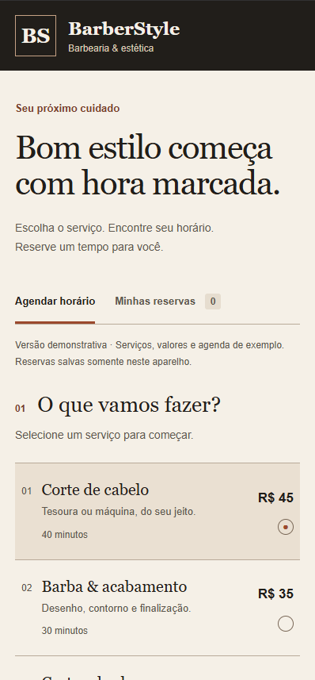

# BarberStyle



## O aplicativo

- Seleção de corte, barba, combo ou design de sobrancelhas.
- Escolha de data e horários de meia em meia hora, com bloqueio de sobreposições conforme a duração do serviço.
- Reserva com nome, consulta de reservas e cancelamento com confirmação.
- Dados persistidos no armazenamento local do navegador ou WebView.
- Layout responsivo, controles nativos, foco visível e mensagens de erro.

**É uma demonstração acadêmica.** Serviços, preços e horários são exemplos, sem cobrança e sem comunicação com uma barbearia real. As reservas ficam apenas no aparelho atual, não há conta, servidor ou sincronização entre dispositivos. Limpar os dados do aplicativo apaga as reservas. Não existe garantia de disponibilidade em uma barbearia real.

## Identidade visual e branding

A identidade clássica foi escolhida pelo aluno: preto quente `#211e1a`, creme `#f5f0e7` e cobre `#9b492d`. O monograma tipográfico provisório **BS** dá continuidade entre o aplicativo, o ícone e a abertura. Georgia destaca os títulos; Arial mantém os controles legíveis e disponíveis offline. As decisões e os motivos estão em [DESIGN.md](DESIGN.md), seguindo a skill AntiSlop durante a implementação.

Identidade visual consistente ajuda a reconhecer o aplicativo na tela inicial e durante a abertura. Branding inclui também a linguagem e a experiência de reservar e cancelar, não apenas o logotipo.

## Executar

Requisitos: Node.js 22 e NPM com acesso à internet.

```bash
npm install
npm run dev
```

Abra o endereço mostrado pelo Vite. Para gerar a versão de produção:

```bash
npm test
npm run build
npm run preview
```

Após a primeira instalação, mantenha o `package-lock.json` no repositório. O workflow usa `npm install` para permitir o primeiro build sem um lockfile; depois é possível trocar por `npm ci` e habilitar o cache do setup-node.

## Ícone e splash screen

Os arquivos fonte estão no mesmo nível do `package.json`:

| Arquivo | Tamanho | Tratamento |
| --- | --- | --- |
| `assets/icon.png` | 1024 × 1024 | Fundo sólido opaco, sem cantos arredondados; monograma central |
| `assets/splash.png` | 2732 × 2732 | Fundo sólido, monograma dentro da zona central de aproximadamente 1200 × 1200 |

Para reproduzir as imagens, execute `npm run assets:source` após instalar as dependências, ou `powershell -File scripts/create-assets.ps1` no Windows. São alternativas de renderização do mesmo monograma; mantenha os PNGs escolhidos versionados como fonte única para o gerador nativo.

O pacote oficial `@capacitor/assets` já está declarado em `devDependencies`. Sua instalação isolada é `npm install @capacitor/assets --save-dev`.

```bash
npm run build
npx cap add android
npm run assets:android
npx cap sync android
npx cap open android
```

Execute `cap add android` apenas na primeira preparação. `npm run assets:android` prepara as camadas derivadas em `assets/android/` e executa `capacitor-assets generate --android --assetPath assets/android`. Esse modo customizado garante o uso da `splash.png` fornecida, em vez de gerar a abertura automaticamente a partir de `icon.png`. Os dois PNGs da raiz de `assets/` continuam sendo a fonte única. O [modo customizado oficial](https://github.com/ionic-team/capacitor-assets#usage---custom-mode) requer essas camadas adicionais.

O comando de geração cria os recursos `mipmap-mdpi`, `mipmap-hdpi`, `mipmap-xhdpi`, `mipmap-xxhdpi`, `mipmap-xxxhdpi` e as variantes de splash em `android/app/src/main/res`. Depois de gerar, inclua a pasta Android no Git, sem arquivos locais ou diretórios de build.

O `capacitor.config.ts` configura duração de 2000 ms, fechamento automático, fundo da marca, `CENTER_CROP` e ausência de spinner. No Android 12 ou superior, a abertura segue o comportamento do sistema, com ícone central e fundo, e pode diferir da imagem de tela inteira. Consulte a [documentação oficial de ícones e abertura](https://capacitorjs.com/docs/guides/splash-screens-and-icons).

## APK automática no GitHub

O arquivo [.github/workflows/android-build.yml](.github/workflows/android-build.yml) executa nas branches `main` ou `master` e também manualmente por `workflow_dispatch`.

O workflow instala as dependências, testa a agenda, gera `dist`, prepara Java 21 e Android SDK, cria o projeto nativo caso ainda não exista, gera as resoluções, sincroniza o Capacitor e compila `assembleDebug`. O artefato se chama **meu-aplicativo-apk** e contém `app-debug.apk`.

1. Crie um repositório GitHub e envie os arquivos deste projeto para `main` ou `master`.
2. Abra **Actions → Construir APK Android (Capacitor)**.
3. Aguarde o resultado da execução. Em caso de erro, consulte o log da etapa que falhou.
4. Em **Artifacts**, baixe `meu-aplicativo-apk` e extraia o ZIP.
5. Transfira a APK ao celular e autorize a instalação por essa origem quando solicitado pelo Android.

A APK é de depuração para a atividade. Publicação em loja exige assinatura de produção e configuração própria.

## Testar no aparelho físico

Para executar pelo Android Studio, instale o SDK indicado pela versão do Capacitor, conecte o celular por USB, ative a depuração USB, aceite a autorização no aparelho e execute `npm run android:open`. Selecione o dispositivo e clique em Run.

Confira o ícone no launcher, a abertura do aplicativo, a escolha de serviço e horário, a persistência após fechar e abrir e o cancelamento. Android pode manter a splash apenas em partidas frias; feche completamente o aplicativo para verificar.

## Estado desta entrega

Código React/TypeScript, estilos, imagens fonte, configuração Capacitor, testes da agenda e workflow foram criados. Na verificação posterior à instalação das dependências, os quatro testes e a checagem TypeScript passaram. A pasta `android/` foi criada e o gerador produziu 74 recursos nativos. **O build web local está bloqueado por uma restrição de criação de processos (`spawn EPERM`); a compilação da APK ainda precisa ser confirmada no GitHub Actions.** A etapa de SDK foi corrigida para instalar apenas `platform-tools`, sem solicitar o pacote removido `tools`. Nenhuma APK bem-sucedida ou execução em aparelho físico foi verificada.

Entregue no Classroom o link do repositório com este README, os assets e o workflow. Não envie apenas o arquivo APK.
